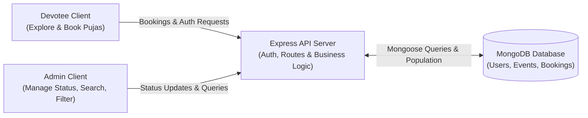
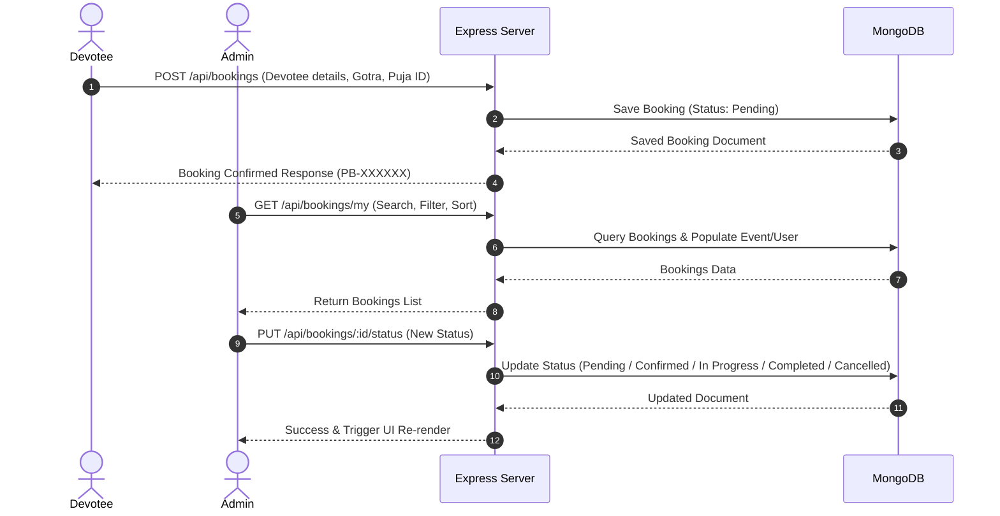

# AARADHYA SETU
A seamless online Puja booking platform connecting devotees with sacred rituals through personalized Sankalp registration and real-time administrative dashboard tracking.

---

## 1. Technology Stack

| Layer | Technologies |
| :--- | :--- |
| **Frontend** | React 18, Vite, Tailwind CSS, React Router DOM, Axios, React Icons |
| **Backend** | Node.js, Express.js, MongoDB, Mongoose, JWT, bcryptjs |

---

## 2. High-Level Architecture



---

## 3. Data Flow (UML Sequence Diagram)



---

## 4. Local Setup

### 1. Server (`server/`)
Create `server/.env`:
```env
PORT=5000
MONGO_URI=mongodb://localhost:27017/aaradhya_setu
JWT_SECRET=your_jwt_secret
FRONTEND_URL=http://localhost:5173
```
Run:
```bash
cd server && npm install && npm run dev
```

### 2. Client (`client/`)
Run:
```bash
cd client && npm install && npm run dev
```
Open **http://localhost:5173** in your browser.
